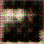
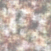

# VAE vs. GAN vs. Diffusion

A hands-on comparison of three image-generation approaches implemented in PyTorch and trained on a cat image dataset using the University of Parma HPC cluster.

## Generated samples

Each GIF shows a model-generated sample at the end of every training epoch. The VAE and GAN reuse a fixed latent input; Diffusion uses the same sampling seed at each epoch. The animations show how generated samples change during training. Each model completed 200 epochs on the same dataset.

<table>
	<thead>
		<tr>
			<th>Variational AutoEncoder (VAE)</th>
			<th>Generative Adversarial Network (GAN)</th>
			<th>Diffusion model</th>
		</tr>
	</thead>
	<tbody>
		<tr>
			<td></td>
			<td></td>
			<td></td>
		</tr>
	</tbody>
</table>

| Model | Approach |
| --- | --- |
| VAE | Learns a compact probabilistic latent space and reconstructs images through an encoder-decoder. |
| GAN | Trains a generator and discriminator in competition to produce realistic images. |
| Diffusion | Learns to denoise samples through a sequence of noise-removal steps using a U-Net. |

## Training loss

These plots show the loss values logged at the end of each epoch for the runs above.

| Plot | Training time |
| --- | --- |
|  | 1 h 33 min 22 s |
|  | 1 h 26 min 46 s |
|  | 5 h 16 min 21 s |

Times are the per-script durations recorded in the Slurm logs.

## Run on the HPC cluster

Submit all three trainings:

```bash
sbatch run_models.slurm
```

To run a single model, pass one flag:

```bash
sbatch run_models.slurm -vae
sbatch run_models.slurm -gan
sbatch run_models.slurm -diffusion
```

Check the job queue with:

```bash
hpc-squeue -u "$USER"
```

The models were trained on the [Cat Faces Dataset on Kaggle](https://www.kaggle.com/datasets/veeralakrishna/cat-faces-dataset), containing 29,843 images. The dataset is not included in this repository; download it from Kaggle and update the `-cats` path in `common.py` before running the scripts. The Slurm script creates a directory under `outputs/` for each job and saves training logs and generated samples there. It also sets up a Conda environment and installs the required packages.

## Models

- `run_vae.py` trains the convolutional VAE.
- `run_gan.py` trains the generator and discriminator.
- `run_diffusion.py` trains a U-Net-based Gaussian diffusion model.
- `common.py` contains shared dataset, dataloader, logging, and seed utilities.
- `run_models.slurm` configures and submits the HPC training workload.
